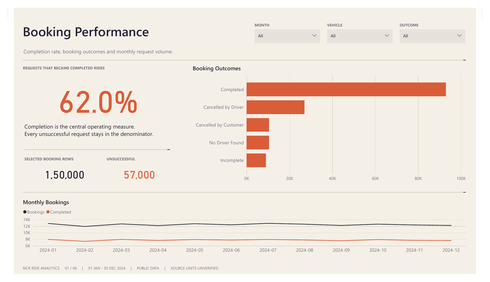
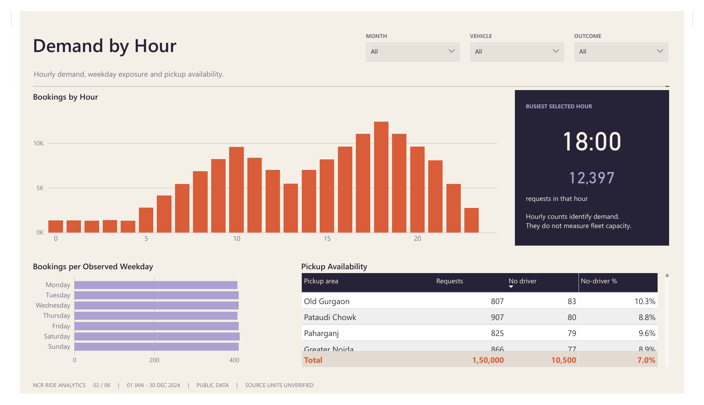
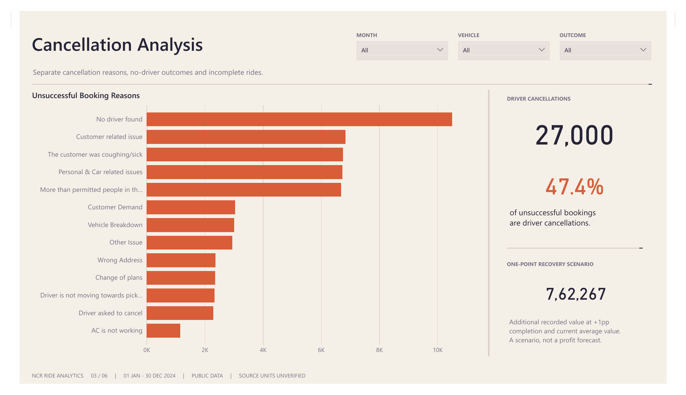
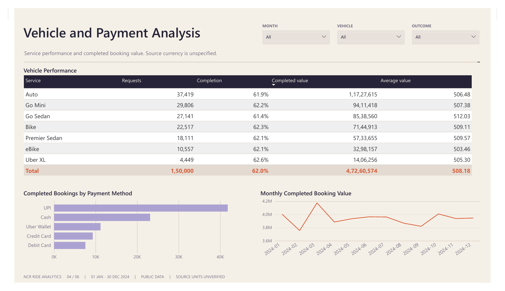
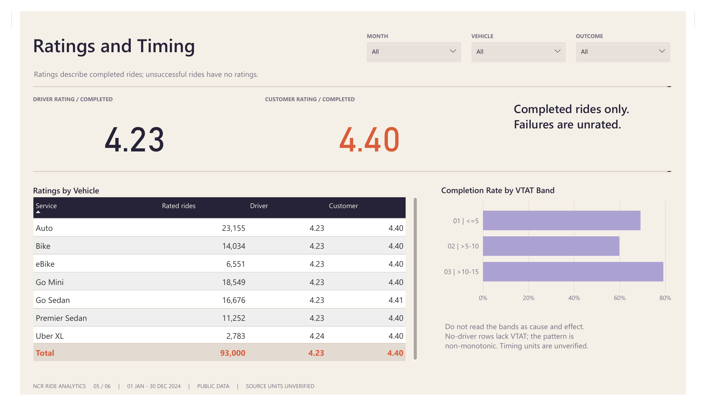
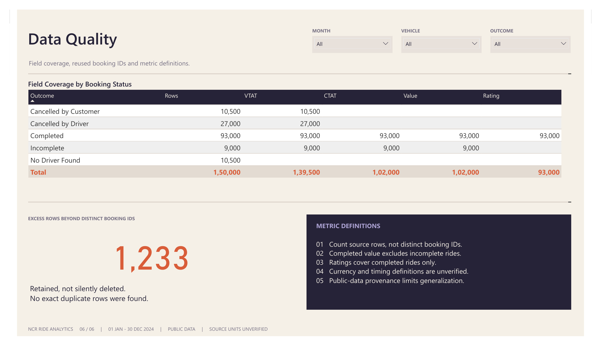
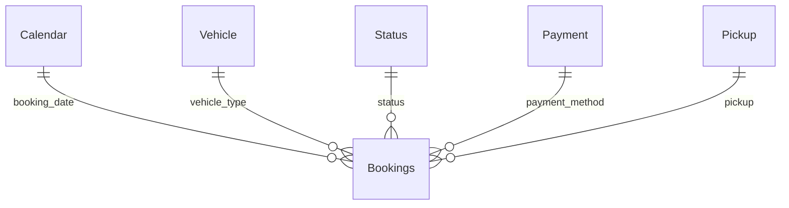

# Uber Ride Analytics: Booking Reliability and Demand Analysis

**SQL · Python · Power BI Desktop · DAX · Data quality · Business analysis**

An analysis of **150,000 NCR ride-booking observations** to identify where requests fail, when demand peaks, and which operational questions deserve investigation. Deliverables include **24 executed SQL analyses**, a **six-page interactive dashboard**, and a **10-page business report**.

**Main finding:** 62% of bookings completed. Driver cancellations account for 18% of all requests and 47.37% of unsuccessful bookings, making cancellation attribution the first investigation priority.



[Download Power BI dashboard](powerbi/Uber%20Ride%20Atlas.pbix) · [Analysis report](report/Uber_Analytics_Report.pdf) · [SQL and results](report/Queries_Run.md) · [Dashboard PDF](report/Uber_Ride_Atlas_Dashboard.pdf)

## Business problem

A high request count does not necessarily translate into completed rides. Cancellations, unavailable drivers and incomplete trips require different responses, while unreliable identifiers and ambiguous value definitions can lead to misleading conclusions.

The objective is to establish a defensible completion baseline, locate the largest failure categories and demand windows, compare service/location performance, and translate the evidence into testable recommendations.

This is a portfolio study of a public Kaggle extract. Sampling and operational provenance are unverified; the findings describe this file.

## What the project delivers

| Component | Scope |
| --- | --- |
| Dataset | 150,000 rows, 21 source fields, 7 vehicle types, 176 pickup locations |
| Period | 1 January - 30 December 2024; 365 consecutive dates including leap day |
| SQL | 24 SQLite queries using window functions, conditional aggregation, grouping and ranking |
| Python | Data cleaning, profiling, query execution, validation and report generation |
| Power BI | 6 pages, 6 model tables, 5 one-way relationships and 35 DAX measures |
| Evidence | Full result CSVs, query execution log, source hash and 12 passing processing checks |

## Key findings and decision implications

| Finding | Evidence | Implication |
| --- | --- | --- |
| Completion reliability is the central issue | 93,000 completed; 57,000 unsuccessful; 62.0% completion | Diagnose cancellation, no-driver and incomplete outcomes separately. |
| Driver cancellations dominate unsuccessful bookings | 27,000 rows; 47.37% of unsuccessful bookings | Verify attribution and underlying records before acting on broad reason labels. |
| Demand is concentrated in the evening | 17:00-20:59 contains 44,118 requests (29.41%); 18:00 has 12,397 | Investigate availability in selected hour/location cells; demand alone does not prove a fleet shortage. |
| Weekday differences are small | 407.98-414.27 bookings per observed weekday | A blanket weekend capacity expansion is weakly supported. |
| Vehicle differences mainly reflect volume | Completion ranges from 61.44% to 62.55%; average completed value from 503.46 to 512.03 | Avoid definitive quality rankings or premium-pricing claims. |
| UPI leads completed transaction mix | 44.98% of completed bookings and 45.02% of completed value | Describe completed payments rather than preferences across every attempted booking. |
| Booking IDs are reused | 1,233 excess rows beyond distinct IDs; no identical rows | Retain observations under a row key and count rows rather than distinct IDs. |

### Demand and availability

The busiest hour has **891 no-driver outcomes**. The dashboard combines hourly demand, weekday-normalized volume and pickup-level no-driver rates. Dispatch events and driver-supply data would be needed to explain the gap.



### Cancellations and recovery

Driver cancellation reasons are nearly evenly distributed across four broad labels. Among customer cancellations, **driver not moving toward pickup** and **driver asked to cancel** total **4,630 observations**, or **44.10%** of that outcome. These are investigation leads, not verified causes.



A **+1 percentage-point completion improvement** means **1,500 additional completions** at fixed request volume. At the current completed average value, that implies **762,267 in illustrative additional booking value**. This sensitivity scenario excludes costs, mix changes and capacity constraints; it is neither a forecast nor profit.

## Analytical decisions

**Preserve observations despite reused IDs.** There are 148,767 distinct booking IDs and 2,457 rows carrying a reused ID. Because those rows are not identical, deduplicating on Booking ID would discard observations without a supported rule. The pipeline assigns a unique `booking_row_key` and retains all rows.

**Keep completed value separate.** Completed rows carry 47,260,574 in booking value; incomplete rides carry another 4,585,609. Combining them exceeds completed value by 9.70%. Currency is unspecified, and neither total establishes recognized revenue, commission, receipts or profit.

**Respect structural missingness.** Ratings cover completed rides only. Value, distance, CTAT and payment appear on completed/incomplete rides. No-driver rows lack VTAT. Missing values remain null; unsuccessful rides are not removed or assigned zero ratings/value.

**Normalize exposure and acknowledge uncertainty.** Monthly/weekday comparisons use bookings per observed day. December ends on the 30th. Location tables retain denominators, and small vehicle differences are interpreted cautiously.

## Six-page dashboard

| Page | Analytical purpose |
| --- | --- |
| Booking Performance | Completion, outcome mix and monthly volume |
| Demand by Hour | Hourly requests, weekday exposure and pickup availability |
| Cancellation Analysis | Reported failure reasons, cancellation share and recovery sensitivity |
| Vehicle and Payment Analysis | Service performance, payment mix and completed booking value |
| Ratings and Timing | Completed-only ratings and source timing-band associations |
| Data Quality | Field coverage, reused IDs and metric definitions |

Month, vehicle and outcome slicers are page-specific. Selecting only Completed yields a conditional 100% completion rate; clear selections to restore the overall baseline.

<details>
<summary><strong>Vehicle and Payment Analysis preview</strong></summary>



</details>

<details>
<summary><strong>Ratings and Timing preview</strong></summary>



</details>

<details>
<summary><strong>Data Quality preview</strong></summary>



</details>

All six previews were rendered from the supplied Power BI PDF export and show actual dashboard pages.

## Technical approach

```text
Kaggle CSV → Python preparation and quality checks → SQLite analysis
                         ├─ Full result CSVs and audit evidence
                         ├─ Power BI import model and DAX
                         └─ Business analysis report
```



The model uses one-way dimension-to-fact filtering at source-row grain. See [metric definitions](report/Data_Dictionary_and_Metrics.md) and [all DAX measures](powerbi/measures.dax).

### Example SQL: monthly completion and growth

This executed query combines conditional aggregation with `LAG`. Month-length effects are evaluated separately in [Q04](sql/04_calendar_normalized.sql).

```sql
WITH m AS (
    SELECT month, COUNT(*) AS bookings,
           SUM(is_completed) AS completed,
           SUM(completed_value) AS completed_value,
           ROUND(100.0 * SUM(is_completed) / COUNT(*), 2) AS completion_pct
    FROM bookings
    GROUP BY month
)
SELECT *,
       ROUND(100.0 * (bookings - LAG(bookings) OVER (ORDER BY month))
             / NULLIF(LAG(bookings) OVER (ORDER BY month), 0), 2)
             AS mom_bookings_pct
FROM m
ORDER BY month;
```

[24 SQL files](sql/) · [Exact queries and result previews](report/Queries_Run.md) · [Complete result CSVs](outputs/)

### Example DAX: filter-aware completion

```dax
Bookings = COUNTROWS(Bookings)
Completed =
    CALCULATE([Bookings], KEEPFILTERS(Bookings[status] = "Completed"))
Completion Rate = DIVIDE([Completed], [Bookings])
```

`KEEPFILTERS` intersects the completed condition with the selected outcome rather than silently replacing it. [Monthly_Reconciliation.dax](powerbi/Monthly_Reconciliation.dax) was run in Desktop to compare monthly DAX totals with SQL.

## Recommended next steps

1. **Verify cancellation attribution.** Review underlying records and distinguish assignment, arrival and trip-start stages before choosing a remedy.
2. **Run a limited operational test.** Preselect evening time/location cells and compare one availability or pickup-communication change against a control. Measure completion with no-driver rate, complaints, safety, driver economics and cost as guardrails.
3. **Establish a data contract.** Resolve persistent IDs, statuses, timestamps and financial definitions. Add supply and cost data before capacity or ROI decisions.

These are proposed investigations. No operational intervention was deployed and no realized uplift is claimed.

## Open or reproduce

**Quick review:** download [the PBIX](powerbi/Uber%20Ride%20Atlas.pbix) and open it in Power BI Desktop. It contains embedded data and requires no Power BI Service connection. The [dashboard PDF](report/Uber_Ride_Atlas_Dashboard.pdf) and the README previews provide a static alternative.

**Rebuild:** Python on Windows and Power BI Desktop. The PDF builder uses Windows Arial fonts.

```powershell
python -m venv .venv
.venv\Scripts\Activate.ps1
pip install -r requirements.txt
python scripts/download_data.py
python scripts/analyze.py
python scripts/redesign_powerbi.py
python scripts/build_professional_report.py
```

The download script retrieves the public Kaggle archive, extracts only `ncr_ride_bookings.csv`, and verifies its recorded SHA-256. If the source changes, it stops. Alternatively, [download manually](https://www.kaggle.com/datasets/yashdevladdha/uber-ride-analytics-dashboard) and put the CSV under `data/raw/`.

The pipeline generates the cleaned CSV and SQLite database. Rebuilding the Power BI project sets `DataFolder` to the local data directory. Open the PBIP, refresh and save in Desktop. When using the committed model definitions directly, set `DataFolder` in Power Query before refreshing. Existing PBIX snapshots are not updated by regenerating source definitions alone.

```text
docs/images/   Six previews from the supplied dashboard export
powerbi/       PBIX, editable PBIP, report/model definitions and DAX
report/        Business report, dashboard PDF, queries and metric definitions
sql/           24 executed SQLite queries
scripts/       Download, preparation, dashboard and report builders
outputs/       Full results, profiling, validation and provenance
data/          Download instructions; raw/derived data are regenerated
```

## Validation and limitations

- **12 processing checks passed:** row-key uniqueness, date parsing, outcome/flag reconciliation and independent SQL-versus-pandas totals, among others.
- All six pages were checked in Desktop. January's slicer results matched SQL: **61.8% completion**, **4,001,547 completed value**, **4,910 unsuccessful bookings**.
- Public-data provenance and representativeness are unverified; do not extrapolate to Uber's company-wide performance.
- Currency, distance and timing units are unverified. Booking value is not accounting revenue or profit.
- Ratings exclude failures. Sparse repeat customer IDs do not support credible retention, churn or lifetime-value conclusions.
- Driver supply, GPS, costs, refunds and experiment assignment are absent; recommendations remain hypotheses.

## Source and attribution

[Uber Ride Analytics Dashboard, Kaggle](https://www.kaggle.com/datasets/yashdevladdha/uber-ride-analytics-dashboard), published by **Yashdev Laddha**. Analysis uses `ncr_ride_bookings.csv`; preview images come from this project's supplied Power BI export. Source rights remain with their respective owners. Raw/cleaned CSVs and the generated database are excluded from this repository; the PBIX includes an embedded snapshot for review.
