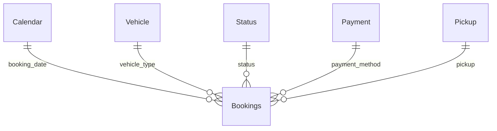

# Data dictionary and metric contract

The raw CSV has 21 fields. Exact observed counts, null percentages and cardinalities are in `outputs/data_dictionary_profile.csv`. No units or accounting meaning are assumed beyond what the source field names establish.

| Source field | Clean field | Interpretation and treatment |
| --- | --- | --- |
| Date | booking_date | ISO date; 2024-01-01 to 2024-12-30, inclusive |
| Time | booking_time | Source time text; hour derived from HH; timezone unverified |
| Booking ID | booking_id | Trimmed identifier; reused IDs retained; never used as fact primary key |
| Booking Status | status | Five mutually exclusive source outcomes |
| Customer ID | customer_id | Trimmed customer identifier; sparse repeats and provenance limit retention analysis |
| Vehicle Type | vehicle_type | Seven source categories |
| Pickup Location | pickup | Named origin category; 176 categories; no coordinates |
| Drop Location | dropoff | Named destination category; 176 categories; no coordinates |
| Avg VTAT | avg_vtat | Source numeric timing field; definition/units unverified; missing on no-driver outcomes |
| Avg CTAT | avg_ctat | Source numeric timing field; definition/units unverified; present on completed/incomplete only |
| Cancelled Rides by Customer | customer_cancel_flag | 1 on customer cancellation, otherwise null in source |
| Reason for cancelling by Customer | customer_cancel_reason | Customer cancellation label; no independent causal verification |
| Cancelled Rides by Driver | driver_cancel_flag | 1 on driver cancellation, otherwise null in source |
| Driver Cancellation Reason | driver_cancel_reason | Driver cancellation label |
| Incomplete Rides | incomplete_flag | 1 on incomplete outcomes, otherwise null in source |
| Incomplete Rides Reason | incomplete_reason | Incomplete outcome label |
| Booking Value | booking_value | Recorded source value; currency unspecified; completed and incomplete only |
| Ride Distance | ride_distance | Numeric source distance; units unspecified; completed and incomplete only |
| Driver Ratings | driver_rating | Completed-only rating, observed 3-5; bounded validation uses 1-5 |
| Customer Rating | customer_rating | Completed-only rating, observed 3-5 |
| Payment Method | payment_method | Five source methods; completed and incomplete only |

## Derived fields

| Field | Rule |
| --- | --- |
| booking_row_key | 1-based source-file row order, unique; stable only for this source ordering |
| month | YYYY-MM from date |
| hour | Integer 0-23 from Time |
| weekday_number / weekday | Monday=1 through Sunday=7; labels sorted by number |
| is_weekend | Saturday/Sunday=1; otherwise 0 |
| is_completed | Completed=1; otherwise 0 |
| is_cancelled | Driver/customer cancellation=1; otherwise 0 |
| is_failed | Every non-Completed status=1 |
| completed_value | Booking Value only for Completed; otherwise null |
| completed_distance | Ride Distance only for Completed; otherwise null |
| failure_reason | First non-null customer, driver, incomplete reason; no-driver mapped to No driver found |
| booking_id_reused | 1 if Booking ID occurs more than once anywhere in this extract |
| vtat_band | Not observed, <=5, >5-10, >10-15, >15, in source units |

## KPI contract

| Metric | Numerator | Denominator / eligibility |
| --- | --- | --- |
| Bookings | Count of booking rows | All selected rows |
| Completion rate | Completed rows | All selected rows |
| Cancellation rate | Customer + driver cancellation rows | All selected rows |
| Unsuccessful rate | Every non-completed row | All selected rows |
| No-driver rate | No Driver Found rows | All selected rows |
| Completed booking value | Sum of value on completed rows | Completed only; not revenue |
| Average completed value | Completed booking value | Completed row count |
| Average completed distance / VTAT / CTAT | Arithmetic mean of eligible non-null values | Completed rows only |
| Driver/customer rating | Mean of source ratings | Completed rated rows only |
| Bookings per observed day | Count of selected rows | Distinct dates with selected booking rows |
| Excess ID rows | Booking rows minus distinct Booking IDs | Current filter context |
| Reused ID rows | Rows flagged reused in the full original extract | Current selected rows |
| Recovery Value 1pp | Selected bookings x 0.01 x selected average completed value | Fixed-volume scenario; not a forecast |

Outcome-specific DAX uses KEEPFILTERS. Status selections therefore change the metric denominator and intersect the numerator. For an unfiltered baseline, clear all selections and compare with `outputs/01_executive_kpis.csv`.

## Model

Relationships are one-way from dimension to Bookings. Null payment keys on unsuccessful rows have no corresponding dimension member; they are retained in the fact and appear as blank under appropriate Power BI filters. No bidirectional filtering or many-to-many relationship is required.
